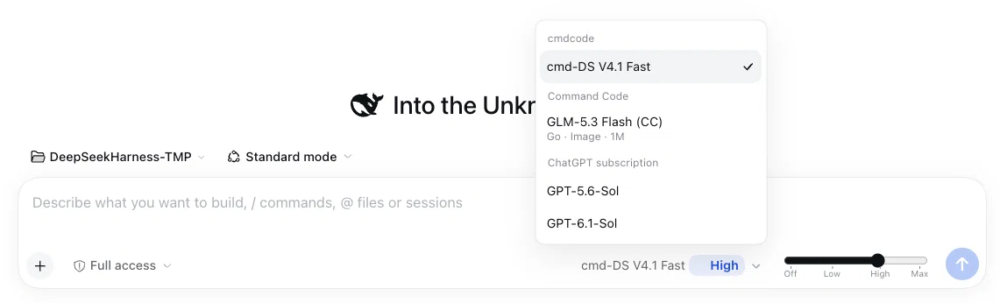

# dsh-model-effort-picker

一个 DeepSeek Harness（DSH）Web profile 插件包，
替换作曲家的模型控件，并把 reasoning effort 做成滑条。

[English](README.md)

- **模型列表直接是一级菜单。** 点击模型控件直接展开按 provider 分组的模型列表（带搜索），
  中间不再有「选择模型」这一层。
- **推理等级做成滑条。** 当前模型支持的档位变成离散刻度，每一档下面标注档位名，
  就放在模型控件右边。拖动松手即切换，不用打开菜单。
- **provider 的设置是读取而非复制。** 若安装了
  [`dsh-codex-subscription`](https://github.com/WSL043/dsh-codex-subscription)，
  本插件会读取它的 `disabledModels`（被你隐藏的模型仍然不显示），并提供它的速度档位，
  写回时走的是该插件自己用的同一个 settings 条目。

作曲家：模型菜单直接展开 provider 分组列表，模型控件右侧是推理滑条（每个档位一个刻度与名称）。



## 安装

这是一个 **profile 插件包**：安装后会作用于该 profile 的所有会话。它没有发布到 npm，
请从本仓库安装。

对你的 DSH agent 说：

```
install the DSH bundle github:baicaihenxiao/dsh-model-effort-picker
```

agent 会调用 `plugin_manager` 的 `install_bundle`，把包加进 profile 并选中该 bundle。
之后刷新 Web 页面（或重启 `dsh web`）。

也可以从本地克隆安装：

```sh
git clone https://github.com/baicaihenxiao/dsh-model-effort-picker
```

```
install the DSH bundle at /absolute/path/to/dsh-model-effort-picker
```

卸载：让 agent 移除 bundle `dsh-model-effort-picker`，或在 DSH 的 Plugins 页面停用它。

- 插件 `1.1.4` 已在 DeepSeek Harness `0.2.0-rc.2` 和 `0.2.1-rc.2` 上验证。
  `peerDependencies` 钉的就是这两个版本，因此 DSH 会拒绝在未经验证的宿主上安装或启用本 bundle
  —— 具体钉了哪些包见[依赖要求](#依赖要求)。

## 更新

从 GitHub 安装会把「安装当次解析到的 commit」钉在你的 profile `pnpm-lock.yaml` 里，
所以**上游新提交不会自动到来**。按你的安装方式选择更新办法：

| 安装方式 | 更新办法 |
|---|---|
| `github:baicaihenxiao/dsh-model-effort-picker` | `dsh plugin --profile <profile> update dsh-model-effort-picker`，或先移除 bundle 再装一次 |
| 本地克隆目录 | 在克隆目录里 `git pull` —— profile 链接的就是该目录 |
| 指定 tag 或 commit | 安装你要的修订：`github:baicaihenxiao/dsh-model-effort-picker#v1.1.4` |

需要知道的几点：

- 用**同一个** spec 再装一次不会移动钉住的 commit；真正重新解析的是 `pnpm update`。
- `plugin_manager` 的 `install_bundle` 会「装包 + 选中 bundle」两件事一起做；而 `dsh plugin`
  这条 CLI 通道只装包，用完之后需要重新选中 bundle。
- 更新后刷新 Web 页面（或重启 `dsh web`）。
- 用 tag 固定版本：`#v1.1.4`；分支名也可以。若用 commit SHA，必须是完整 40 位 ——
  pnpm 无法解析缩写 SHA。
- 查看已装版本：

  ```sh
  cat ~/.dsh/profiles/<profile>/node_modules/dsh-model-effort-picker/package.json
  ```

## 依赖要求

- 一个 DSH Web profile。本插件扩展 `conversation.input.model` 与
  `conversation.input.activity`（由 `@deepseek-ai/dsh-client-ui-conversation` 声明），
  并从 `@deepseek-ai/dsh-client-ui-model-selection` 读取会话的模型目录 —— 两者都随 DSH 提供，
  所以本包自身不声明任何依赖。
- 一个**已验证过的 DSH 版本**。`peerDependencies` 把它实际使用的三个宿主包
  （`@deepseek-ai/dsh-client-locale`、`@deepseek-ai/dsh-client-ui-conversation`、
  `@deepseek-ai/dsh-client-ui-model-selection`）钉在 `0.2.0-rc.2 || 0.2.1-rc.2`，`engines` 与宿主的 Node 范围
  （`^22.19.0 || >=24.0.0`）一致。DSH 的插件管理器会把每个 `@deepseek-ai/dsh*` peer 范围
  **与 DSH 运行时版本**比对，不匹配则拒绝安装或启用 —— 所以在未验证的宿主上是**明确报错**，
  而不是渲染出一个坏掉的输入区。验证过的新宿主版本会追加到这里；若确需提前使用，
  可用 `dsh plugin allow-version`（或插件管理器）授予**精确版本豁免**，即显式接受该风险。
- `react` 由浏览器模块表提供，除此之外不导入任何东西。

## 行为与限制

- **座位优先级。** 模型控件是可被遮蔽的座位。本插件以优先级 `-20` 占用，
  低于官方选择器（`0`）与 `dsh-codex-subscription` 的覆盖（`-10`），因此只有一个会渲染。
  其他插件仍可用更低的优先级接管。本插件占用期间，其他插件自己的作曲家模型菜单不会渲染。
- **滑条何时出现。** 仅当当前模型声明了至少两个推理档位时出现；没有 reasoning 元数据的模型不显示，
  **元数据里没有档位列表的同样不显示**（这种情况直接不渲染，而不是报错）。
  适配器若把默认档留空，会多出一个「提供方默认」刻度。
- **速度档位。** 快速档按 provider 自身的 fallback 判定提供；极速档只在它**当前就是**极速时列出，
  因为只有 provider 的宿主半区知道哪些模型声明了极速。输出详细程度不在这里提供 —— 仍在 provider
  自己的设置页。
- **尺寸固定。** 档位名占轨道下方 14px 一行（刻度线 → 2px 间隙 → 档位名）；轨道与刻度标签都由本插件绘制，
  切换档位不会改变这个块的尺寸。
- **触发器宽度。** 模型按钮里的档位说明按**内容自适应**（与官方控件一致），因此别的插件在它上面画的底色会贴合文字，
  而不会被预留宽度撑开。工具行是右对齐的，所以档位名变长时是按钮**向左扩张**，滑条与发送按钮位置不变；
  模型名会最先让出这部分空间，因而更早出现省略号。
- **刻度间距。** 每个刻度都居中在自己的停位上（包含首尾）—— 之前首尾是贴边锚定的，
  所以档位一多间距就不均匀。轨道会随档位增多而加宽（四档 150px，之后每多一档 +26px，
  上限 230px），首尾标签另有 14px 预留空间，因此名称之间保持间距而不是挤在一起。
  比两档间距更宽的名称会被截到这个间距并显示省略号（悬停时原地展开全称，盖住相邻标签；
  首尾两档向内展开），所以
  `Ultra (DSH parallel · xhigh)` 这类长名不会压到相邻标签；从六档起间距不到 39px，
  `Medium` 这样短的名称也会被截断。
- **轨道更细。** 轨道由本插件自绘（3px 轨道 + 9px 滑块），而不是交给原生 range 控件 ——
  原生的轨道与滑块尺寸自持，把盒子改矮只会把它裁掉。填充部分的末端对齐滑块圆心，
  因为轨道两端各内缩了滑块半径；选中档位右侧的那一段用比标签更淡的颜色，
  这样只有填充部分是「亮的」。
- **档位配色。** 刻度标签按固定六色渐变着色，低→高，色值写在 `client.js` 的 `TINT_RAMP`：

  | # | 颜色 | 在渐变中的位置 |
  |---|---|---|
  | 1 | `#475569` | 石板灰，最低档 |
  | 2 | `#2563EB` | 蓝 |
  | 3 | `#4F46E5` | 靛 |
  | 4 | `#6D28D9` | 紫罗兰 |
  | 5 | `#7E22CE` | 紫 |
  | 6 | `#86198F` | 洋红，最高档 |

  标签颜色是在这些色标之间**插值**得到的，所以任意档位数都覆盖，不会重复配色：
  正好六档时每档依次命中一个上面的颜色；档位更少时则均匀取样
  （`node check.mjs` 对 4/6/8 档、以及「六档精确命中该色盘」都做了断言）。

  `TINT_STRENGTH`（默认 100）是「纯度 ↔ 对比度」的旋钮：100 时每个标签就是色盘本色，
  在亮色配色下最显眼；把它调低会让所有档位向标签色靠拢 —— 如果你在**暗色背景**下觉得颜色发闷，
  就调这个值（这个色盘偏深的一端在暗色下本来就离背景太近）。

  标注文字也调为 10px、字重 500：小字号配细字重时，抗锯齿会把中间色与背景混合，
  看起来像周围文字的淡色版本，而不是它自己的颜色。

## 开发

纯 JavaScript，无构建步骤。`client.js` 是浏览器半区并被直接加载；`index.js` 是空的宿主半区。

```sh
node check.mjs   # 加载插件包，并断言它注册的座位
```

profile 以软链方式安装本目录，因此改动 `client.js` 后，页面重新加载模块即可生效。

### 发布

改 `package.json` 里的 `version`，在 [CHANGELOG.md](CHANGELOG.md) 记一条，然后打 tag 并发布：

```sh
git tag -a vX.Y.Z -m "vX.Y.Z"
git push origin main --follow-tags
gh release create vX.Y.Z --title vX.Y.Z --notes-from-tag
```

## 许可证

[MIT](LICENSE)
